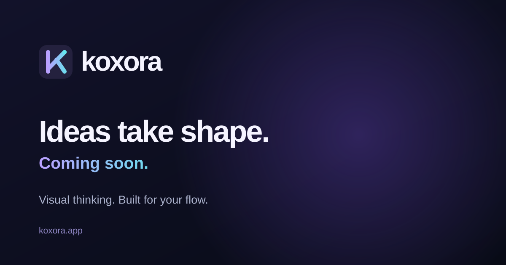
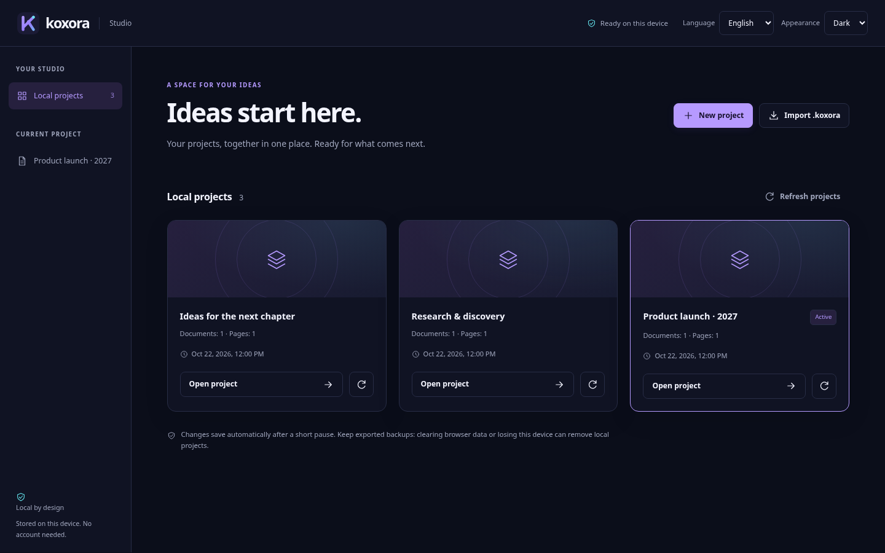
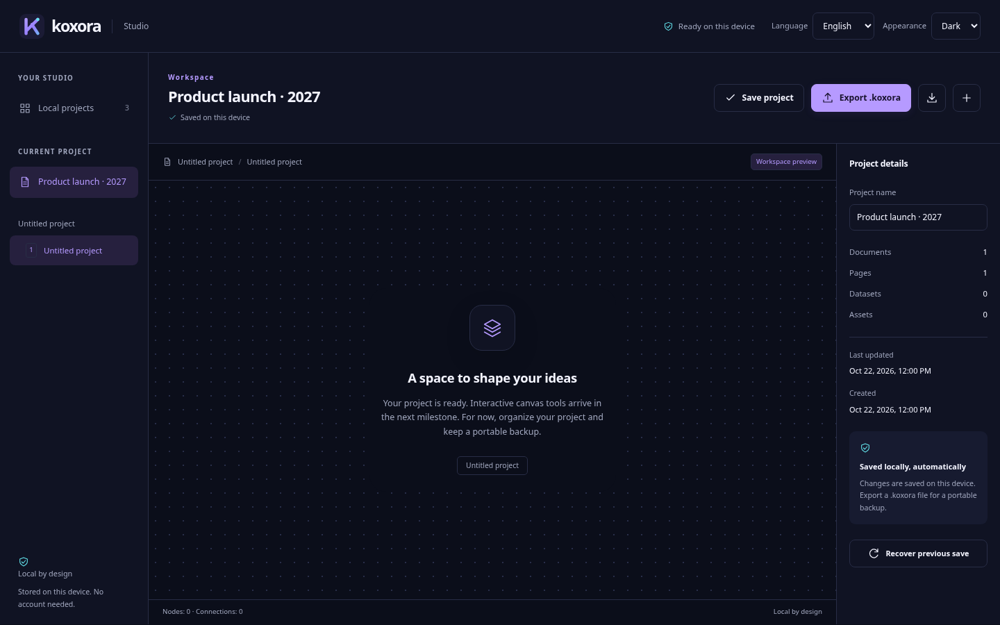
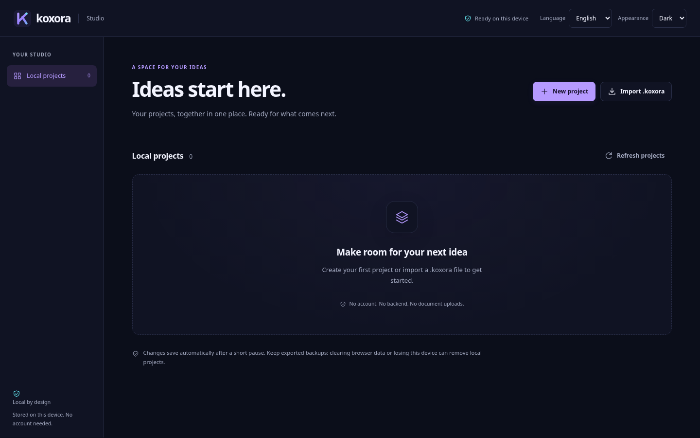
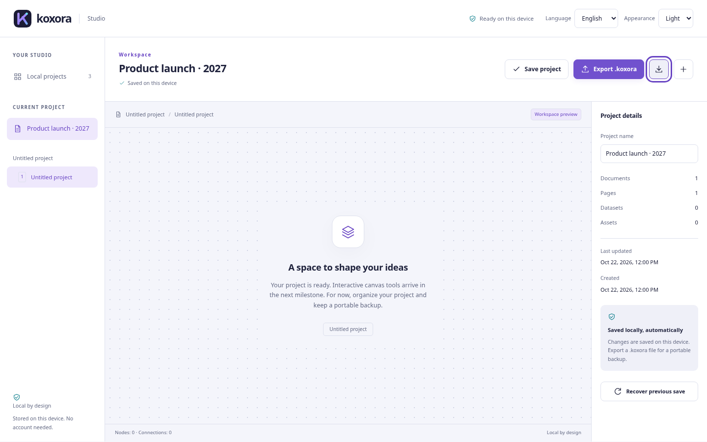
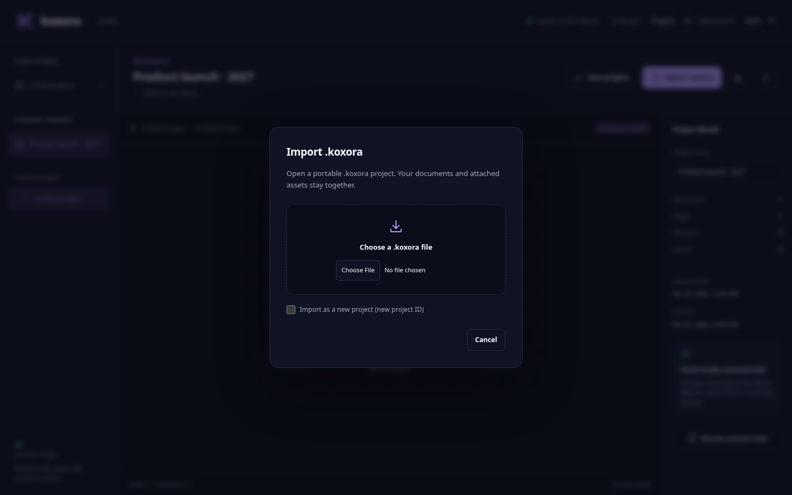

# Phase 2.1 dashboard, workspace and native Save As

## Scope and design source

Implemented for Product Owner review on 2026-10-22; no merge approval is implied. This is the requested UX revision of PR #10, retaining the project format and local persistence foundation. It covers CORE-001 through CORE-007, CORE-009, CORE-010, CORE-012, CORE-014 through CORE-019 and the existing localization/accessibility constraints.

The Product Owner supplied the official `logo.svg`, `favicon.svg`, `og-image.svg` and website `styles.css`, and identified <https://koxora.app> as the reference. The exact supplied logo is used in `packages/ui/src/assets/logo.svg` and native `icons/source.svg`; Tauri's icon generator derives PNG/ICO/ICNS assets from it. The original website brand image and CSS are retained under `reference/`. Formatting of the reference CSS is normalized by Prettier. These assets are design references, not application instructions or newly licensed third-party artwork.

The website's navy/indigo surfaces, violet/cyan accents, subtle borders, spacing and editor columns inform reusable shared design tokens. The original English/light default and persisted preferences remain intact; German and dark mode are selectable independently. Typography uses local system fonts, with no external font request. A direct website fetch returned HTTP 403 in the execution environment, so the visual comparison uses the actual supplied website artwork and CSS rather than claiming a captured live editor screenshot.

## Behavior and component boundaries

- The dashboard has create/import actions, project cards with validated names, dates, document/page counts and active-project markers. Discovery/loading and open operations report progress. Damaged records remain visible for recovery.
- Opening a card switches immediately to a workspace after successful loading, updates its heading/details/navigation and moves keyboard focus to its title. Navigation back to local projects retains the active session and autosave.
- The workspace provides actual document/page navigation, a central canvas placeholder, project naming/details, save/export actions, and confirmed previous-save recovery. The selected page updates the breadcrumb and content counts. The placeholder explicitly explains that rendering and editing arrive in the next milestone; there are no pretend shape tools or zoom controls.
- Shared `Mark`, `Icon` and modal `Dialog` components use semantic CSS tokens in `packages/ui`. Native HTML dialogs contain keyboard focus, support Escape and restore trigger focus. The shell offers skip navigation, visible keyboard focus, live operation feedback and localized notifications.
- Responsive columns collapse into stacked content at smaller widths. The native minimum remains 360 × 600. The project model, ZIP bytes and persistence conflict/recovery contracts are unchanged; the repository exposes additional validated summary metadata.

## Native export boundary and integrity

The shared UI invokes `project_export` with archive bytes, a suggested title and localized labels. It never sends a destination path. Rust invokes the official `tauri-plugin-dialog` API on a blocking worker; the main event loop remains available. No general filesystem or frontend dialog capability is granted.

The native chooser selects a path and normalizes its extension to `.koxora`. For an existing regular file, a separate localized confirmation displays the actual normalized path before any write. Some OS dialogs may additionally show their own replacement prompt. Declining either prompt or cancelling selection writes nothing. A directory, symbolic link, unreadable file or existing file above the 64 MiB export bound fails explicitly.

A random exclusive temporary file in the destination directory is written and synchronized. New destinations use `tempfile::persist_noclobber`; existing destinations use atomic `persist` after confirmation and a second content/mtime check. Failure cleans up staging and retains the old destination until commit. Existing contents are never truncated in place. The final path is returned only after publication and Unix directory synchronization. If synchronization fails after commit, the file may already exist even though the UI reports failure; inspect the destination before retrying.

There is no portable atomic compare-and-replace primitive for arbitrary external writers: an external modification in the small interval between the last check and confirmed replacement can still race. The normal dialog-duration change is detected and rejected, and new-file races never overwrite. Parent-directory symlink changes and hostile same-user filesystem mutation are not a sandbox boundary. The user-selected path grants a one-operation write; imported project data cannot choose it. Power-loss guarantees depend on the filesystem/OS; non-supporting filesystems fail without a non-atomic fallback. A crash may leave an uncommitted staging file.

Internal autosave remains in app-data snapshots/IndexedDB. Export includes the active in-memory project, even if local saving failed, and does not mark it locally saved. Browser export continues to use browser downloads.

## Acceptance

1. Start with a fresh profile: English/light, official logo, no registration or network requirement. Switch to dark mode and German; reload and verify preferences.
2. Create/name two projects. Return to **Local projects**, inspect metadata/active state, then open either card with the keyboard. Its title, focus, details and page navigation must visibly change.
3. Import `complete-v1.koxora`; switch pages and verify breadcrumb/counts. Export unchanged and compare SHA-256. The canvas explanation must remain honest about unavailable rendering/editing.
4. Resize through 1440, 1024, 800, 600 and 360 px widths; controls must remain reachable without horizontal page overflow. Open/cancel import with keyboard and Escape. Confirm recovery once and cancel it once.
5. On Linux, Windows and macOS, choose **Save as…**, change directory/name, verify `.koxora` and validate with `unzip -t`. Cancel and verify no write. Reject existing-file replacement and compare its hash; approve and verify complete replacement. Check success includes the chosen path.
6. Verify saved projects reopen offline after restart. Repeat invalid import, duplicate ID, two-tab conflict and recovery checks from the [storage acceptance guide](../development/project-storage.md).

Unsigned CI packages require manual native GUI acceptance on the target OS, including CachyOS. Browser tests of the native IPC contract use a mock; they do not prove the OS chooser's appearance or platform overwrite prompt behavior.

## Visual comparison

The supplied website artwork is the reference below. Application screenshots are captured from the production browser build with synthetic projects; they are not native OS-dialog screenshots.

| Dashboard                                                        | Workspace                                           |
| ---------------------------------------------------------------- | --------------------------------------------------- |
|         |    |
|  |  |

[German workspace at 360 px width](screenshots/workspace-small-de.png). Screenshots can be reproduced with `node scripts/capture-studio.mjs` against a production preview on port 4174 (`KOXORA_PREVIEW_URL` overrides it). `PLAYWRIGHT_CHROMIUM_EXECUTABLE_PATH` optionally selects installed Chromium.

## Validation evidence

Local checks on 2026-10-22: full `pnpm check` passed (TypeScript, ESLint, formatting, 93 unit tests, documentation links and 453 JavaScript license records); production build passed; dependency audit reported no known vulnerabilities. The expanded browser suite passed 32 Chromium desktop/mobile cases, covering existing storage/offline/failure flows, opening and focus, page navigation, resized windows, modal keyboard behavior, and native export success/cancel/error via the IPC harness.

The isolated Rust storage/export harness passed 13 tests and Clippy with warnings denied. Full local `cargo check --locked` stopped at the missing GLib development prerequisite; it does not establish Tauri integration success. Existing GitHub Actions run full native build, Clippy/tests and package generation on Linux, Windows, Apple Silicon macOS and Intel macOS, plus the unchanged Rust supply-chain gate. The final PR records the actual workflow results and artifact links.

Independent review examined the implementation and tests and reran TypeScript, ESLint and all 93 unit tests. Its external-writer concurrency qualification is incorporated above. A subsequent browser test exposed a modal Tab-wrap issue; the shared dialog now explicitly wraps first/last focus, and desktop/mobile regression tests pass. Final screenshot review also caught the CSS reset removing native dialog centering; explicit auto margins and viewport height bounds correct it, with a browser geometry assertion. Native OS dialogs remain a manual acceptance step.
